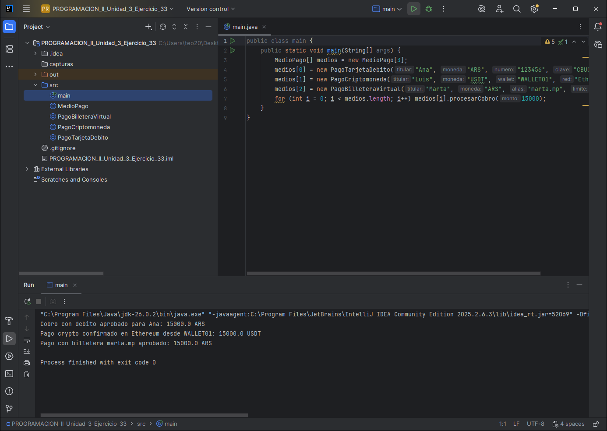

# PROGRAMACIÓN II — Unidad 3, Ejercicio 33: Jerarquía de Medios de Pago Electrónico

Trabajo práctico de Programación II. Este repositorio contiene la resolución en Java del ejercicio 33 de la Unidad 3.

## Consigna

#### Contexto

En las plataformas modernas de comercio electrónico, los métodos de pago digitales comparten atributos comunes como el titular de la cuenta, la moneda de operación y el saldo disponible. No obstante, las tarjetas de débito bancarias, las criptomonedas y las pasarelas de pago por saldo virtual operan bajo validaciones de comisiones y protocolos de confirmación totalmente distintos.

#### Consigna

Modelar un sistema financiero en Java aplicando herencia para establecer una clase base de medios de pago y sus respectivas especializaciones tecnológicas.

#### Desarrollo requerido

- Crear la clase base MedioPago con atributos genéricos como titular, moneda y un método abstracto o general procesarCobro(double monto).
- Implementar clases hijas como PagoTarjetaDebito (con atributos de número de tarjeta y clave interbancaria), PagoCriptomoneda (con dirección de wallet y red blockchain) y PagoBilleteraVirtual (con alias y límite diario).
- Asegurar el uso correcto de la herencia y la reutilización de código mediante constructores parametrizados en la clase padre.
- En el método main, armar una colección de medios de pago variados, ejecutar transacciones polimórficas y mostrar los comprobantes resultantes por consola.

## Estructura del repositorio

```
PROGRAMACION_II_Unidad_3_Ejercicio_33/
├── README.md
├── capturas/
│   └── consola.png
└── src/
    ├── main.java   # clase con el método main
    ├── MedioPago.java
    ├── PagoBilleteraVirtual.java
    ├── PagoCriptomoneda.java
    └── PagoTarjetaDebito.java
```

## Funcionamiento y lógica

El ejercicio usa una **clase abstracta** para procesar cobros con distintos medios de pago.

### `MedioPago` (clase abstracta)

Tiene `titular` y `moneda` (`protected`) y el método abstracto `procesarCobro(double monto)`.

### Medios de pago concretos

- **`PagoTarjetaDebito`:** guarda el número de tarjeta y la clave interbancaria; aprueba cualquier monto positivo.
- **`PagoCriptomoneda`:** guarda la wallet y la red blockchain; confirma el pago indicando la red y la wallet de origen.
- **`PagoBilleteraVirtual`:** guarda el alias, un límite diario y lo acumulado en el día. Solo aprueba el pago si no se supera el límite diario.

### `main`

Crea un arreglo `MedioPago[]` con un débito de Ana (ARS), un pago en USDT de Luis por Ethereum y la billetera de Marta (límite de $50000), y cobra **15000** con cada uno. Los tres cobros se aprueban, y cada medio muestra su propio mensaje.

## Ejecución

Captura de la consola de IntelliJ IDEA ejecutando el programa:



Salida obtenida:

```
Cobro con debito aprobado para Ana: 15000.0 ARS
Pago crypto confirmado en Ethereum desde WALLET01: 15000.0 USDT
Pago con billetera marta.mp aprobado: 15000.0 ARS
```
